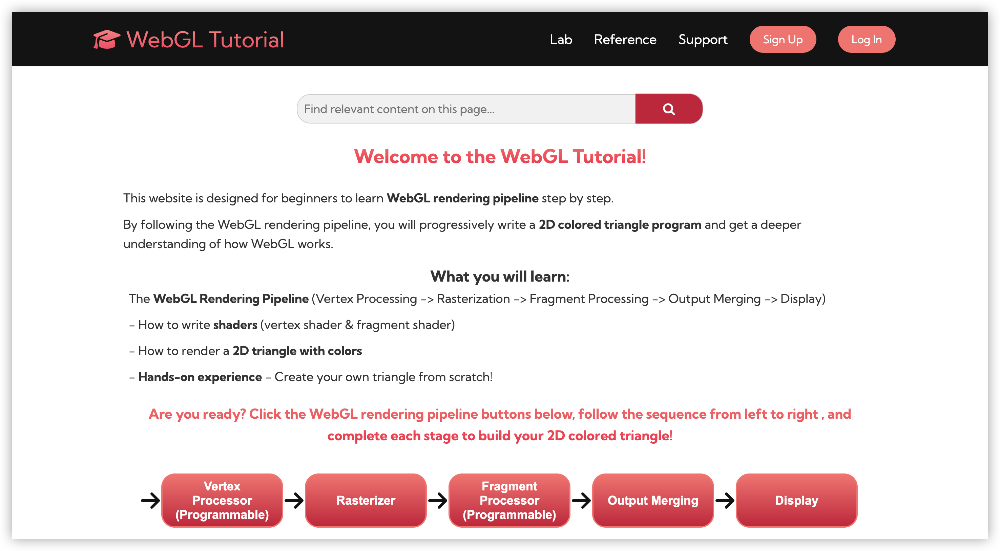
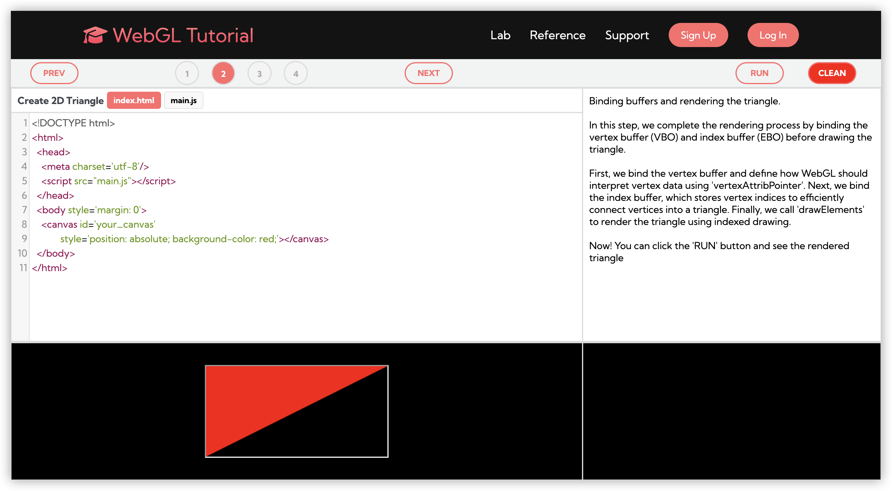
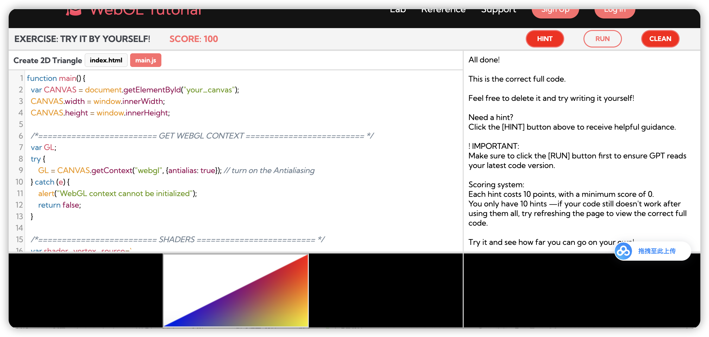
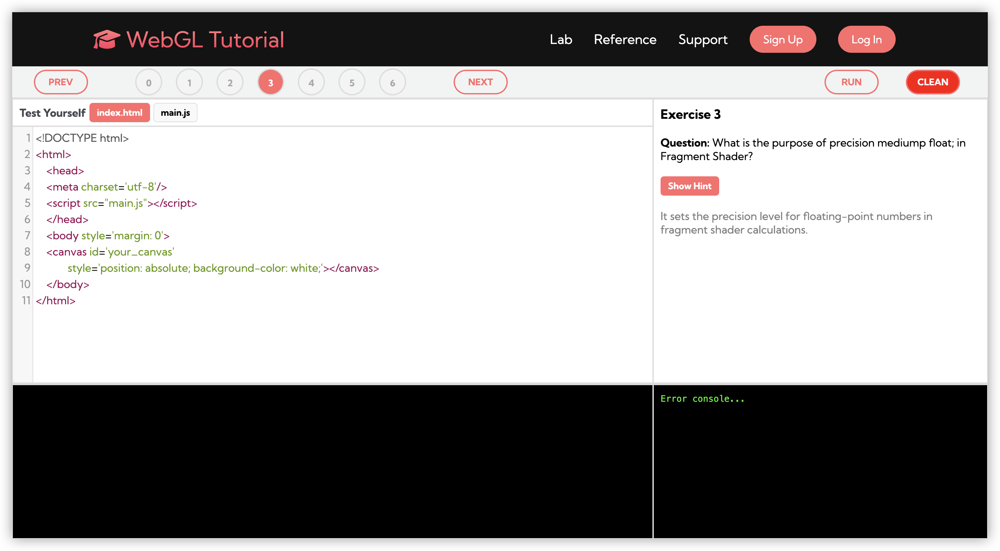
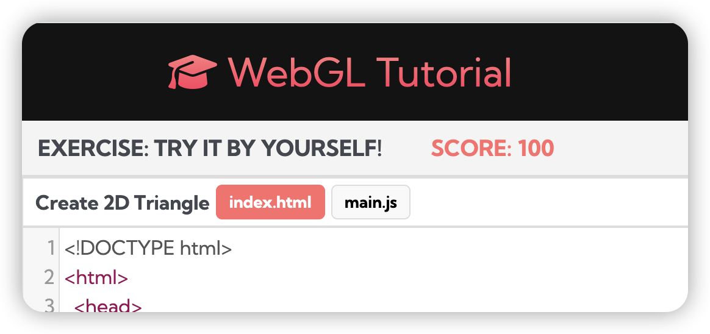
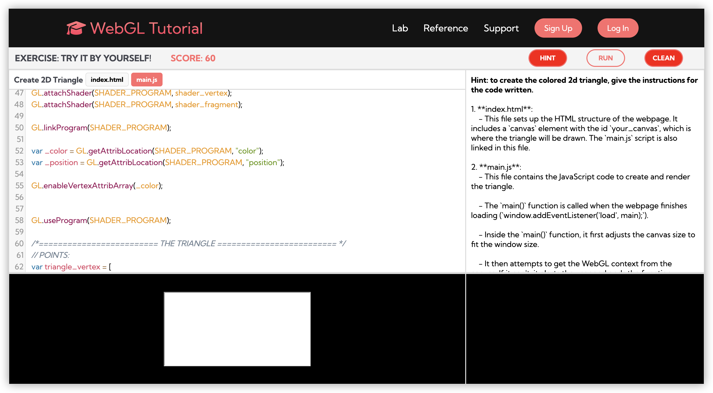

# WebGL Learning Platform with AI-Assisted Hints
# WebGL 交互式学习平台｜AI 辅助学习提示

An interactive educational platform designed to help beginners understand the WebGL rendering pipeline through structured tutorials, hands-on coding exercises, real-time visual feedback, and AI-assisted learning hints.

一个面向 WebGL 初学者的交互式教学平台，通过分步骤教程、在线代码练习、实时渲染反馈及 AI 辅助提示，帮助用户更直观地理解 WebGL 图形渲染流程。

## Live Demo | 在线体验

**[Try the WebGL Learning Platform | 点击体验 WebGL 学习平台](https://interactive-webgl-learning-platform.onrender.com/)**

The platform is publicly accessible through the link above. Visitors can explore the learning interface and available interactive features without installing the project locally.

点击上方链接即可访问在线演示网站，无需在本地安装 Node.js 或配置开发环境。

> **Note / 访问说明**
>
> The demo is hosted on Render's free tier. The first visit may take some time to load if the server has been inactive. AI-assisted features may be unavailable depending on API configuration.
>
> 网站部署于 Render 免费服务器，长时间无人访问后可能进入休眠状态，首次加载可能需要等待。AI 辅助功能是否可用取决于服务器的 API 配置。

---

## 1. Project Overview | 项目简介

**English**

This project was developed as my Bachelor's Final Year Project at the University of Manchester.

The platform aims to address a common challenge in learning computer graphics: beginners often find the WebGL rendering pipeline difficult to understand through theoretical explanations alone.

To improve the learning experience, I developed an interactive educational website that combines structured tutorials, practical coding exercises, visual feedback, and AI-assisted contextual hints.

The project integrates web development, educational interaction design, user experience (UX) principles, and AI-assisted learning.

**中文**

本项目是我在英国曼彻斯特大学计算机科学本科期间完成的毕业设计（Final Year Project）。

项目主要针对计算机图形学学习中的一个常见问题：WebGL 渲染管线涉及多个抽象的处理阶段，初学者仅通过文字或理论讲解，往往难以理解各阶段的作用及其联系。

为改善这一学习体验，我设计并开发了一个交互式 WebGL 教学网站，将结构化教程、在线代码练习、实时可视化反馈与 AI 辅助提示相结合。

项目涉及前后端开发、教育类产品交互设计、用户体验（UX）设计以及 AI 辅助学习功能的实现。

---

## 2. Key Features | 核心功能

### 2.1 Step-by-Step Tutorials | 分步骤交互式教程

**English**

The platform breaks down the WebGL rendering pipeline into smaller learning modules, allowing beginners to explore different rendering stages progressively.

**中文**

将 WebGL 渲染管线拆分为多个学习模块，帮助初学者按照学习顺序逐步理解不同渲染阶段的功能与作用。

### 2.2 Interactive Coding Playground | 在线交互式代码练习

**English**

An integrated coding environment allows users to experiment with WebGL-related code and observe the corresponding rendering results.

**中文**

集成在线代码编辑环境，支持用户在学习过程中修改相关代码，并观察对应的图形渲染结果，实现边学边练。

### 2.3 AI-Assisted Contextual Hints | AI 辅助上下文提示

**English**

The platform integrates the OpenAI API to provide contextual learning hints, supporting users when they encounter difficulties during coding exercises.

**中文**

通过集成 OpenAI API，为用户在代码练习过程中提供与学习任务相关的上下文提示，帮助用户理解问题并继续完成练习。

### 2.4 Real-Time Rendering and Error Feedback | 实时渲染与错误反馈

**English**

Users can view rendering outputs and error information while experimenting with code, supporting iterative learning and debugging.

**中文**

提供实时图形渲染结果与错误信息展示，帮助用户在修改代码后及时观察结果，并通过反复尝试理解和排查问题。

### 2.5 Progressive Disclosure Learning Design | 渐进式学习设计

**English**

The learning interface follows progressive disclosure principles, presenting information in manageable stages to reduce unnecessary cognitive load for beginners.

**中文**

采用渐进式信息呈现（Progressive Disclosure）的交互设计思路，将复杂学习内容分阶段展示，避免一次性呈现过多信息，降低初学者的理解负担。

### 2.6 User Authentication | 用户注册与登录

**English**

The platform includes sign-up and login interfaces as part of the overall learning website.

**中文**

设计并实现用户注册与登录相关页面，构建较完整的教学网站使用流程。

---

## 3. Tech Stack | 技术栈

| Category / 类别 | Technologies / 技术 |
|---|---|
| Frontend / 前端开发 | HTML, CSS, JavaScript |
| Backend / 后端开发 | Node.js, Express |
| Graphics / 图形渲染 | WebGL |
| Code Editor / 代码编辑器 | CodeMirror |
| AI Integration / AI 集成 | OpenAI API (GPT) |
| UX Design / 交互设计 | Progressive Disclosure |
| Evaluation / 用户体验评估 | System Usability Scale (SUS) |

---

## 4. System Design | 系统设计

**English**

The platform uses a Node.js and Express backend to serve the educational website and handle AI-related requests.

The frontend provides tutorial interfaces, coding exercises, and WebGL rendering functionality. The AI hint feature communicates with the backend, which acts as an intermediary for OpenAI API requests.

**中文**

平台采用 Node.js 与 Express 构建后端服务，负责提供网站静态资源及处理 AI 相关请求。

前端主要负责教程展示、交互式代码练习和 WebGL 图形渲染。AI 提示功能通过后端接口与 OpenAI API 进行通信，实现教学场景中的智能辅助。

---

## 5. Screenshots | 项目界面展示

### 5.1 Homepage | 平台首页



*Homepage of the WebGL learning platform / WebGL 交互式学习平台首页*

### 5.2 Tutorial Module | 分步骤教学模块





*Structured tutorials with progressive learning steps / 通过分步骤交互设计组织教学内容*

### 5.3 Exercise and Score System | 练习与评分模块





*Interactive exercises and score feedback / 在线交互式练习与评分反馈*

### 5.4 AI-Assisted Hint System | AI 辅助提示模块



*Contextual learning hints powered by the OpenAI API / 基于 OpenAI API 的上下文学习提示*

---

## 6. User Evaluation | 用户体验评估

**English**

The platform was evaluated through a usability study involving 18 participants.

The evaluation used the System Usability Scale (SUS) to assess the usability of different learning approaches.

According to the project evaluation results, the AI-assisted version achieved the highest SUS score among the evaluated learning methods.

This evaluation provided feedback on the potential value of integrating AI-assisted hints into an interactive educational environment.

**中文**

项目通过一项包含 **18 名参与者**的用户可用性研究，对不同学习方式的使用体验进行了评估。

研究采用系统可用性量表（System Usability Scale，SUS）衡量用户对学习方式的可用性感受。

根据项目评估结果，**AI 辅助学习版本在所比较的学习方式中获得了最高的 SUS 评分**。

该评估为分析 AI 辅助提示在交互式教学环境中的应用价值提供了用户反馈依据。

> The evaluation findings are based on the project's participant sample and should not be interpreted as evidence of effectiveness across all learners.
>
> 以上结果基于本项目的参与者样本，不代表该学习方式对所有用户均具有相同效果。

---

## 7. Project Structure | 项目结构

```text
webgl-educational-tool/
├── public/
│   ├── css/
│   ├── js/
│   ├── images/
│   ├── index.html
│   ├── login.html
│   ├── signup.html
│   ├── exercise.html
│   └── ...
├── server.js
├── package.json
├── package-lock.json
└── Readme.md
```

**English**

The `public` directory contains the frontend pages, stylesheets, JavaScript files, and image resources. The Express server handles website hosting and backend API requests.

**中文**

`public` 文件夹存放网站的前端页面、样式文件、JavaScript 脚本及图片资源；Express 后端负责网站资源访问及 API 请求处理。

---

## 8. Local Installation | 本地运行

### Requirements | 环境要求

- Node.js
- npm

### Step 1. Clone the Repository | 克隆项目

```bash
git clone https://github.com/Zora-xiaofu/Interactive-WebGL-Learning-Platform-WithAL-Hints.git
cd Interactive-WebGL-Learning-Platform-WithAL-Hints
```

### Step 2. Install Dependencies | 安装依赖

```bash
npm install
```

### Step 3. Configure Environment Variables | 配置环境变量

For local AI functionality, configure an `OPENAI_API_KEY` environment variable. Do not commit real API keys to GitHub.

如需在本地使用 AI 提示功能，请配置 `OPENAI_API_KEY` 环境变量。不要将真实 API 密钥上传至公开仓库。

### Step 4. Start the Server | 启动服务器

```bash
node server.js
```

### Step 5. Open the Website | 访问网站

http://localhost:3000

---

## 9. Future Improvements | 后续优化方向

**English**

Potential future improvements include:

- More advanced WebGL tutorials and coding exercises
- Real-time AI Q&A support
- Further improvements to interface design and user experience
- Database-backed user authentication
- Additional usability testing with a larger participant sample

**中文**

后续可进一步探索以下优化方向：

- 扩展 WebGL 教学内容与进阶代码练习
- 增加实时 AI 问答支持
- 持续优化页面视觉设计和用户交互体验
- 引入数据库支持用户认证与信息管理
- 扩大用户测试样本，进一步评估平台可用性

---

## 10. Project Information | 项目信息

| Item / 项目 | Details / 说明 |
|---|---|
| Project Type / 项目类型 | Bachelor's Final Year Project / 本科毕业设计 |
| University / 学校 | The University of Manchester / 曼彻斯特大学 |
| Discipline / 专业 | Computer Science / 计算机科学 |
| Project Focus / 项目方向 | Educational Technology, Web Development, UX Design, AI-Assisted Learning / 教育技术、Web开发、交互设计、AI辅助学习 |

**This project was developed for academic and educational purposes.**

**本项目为本科毕业设计及学术教学研究项目。**
